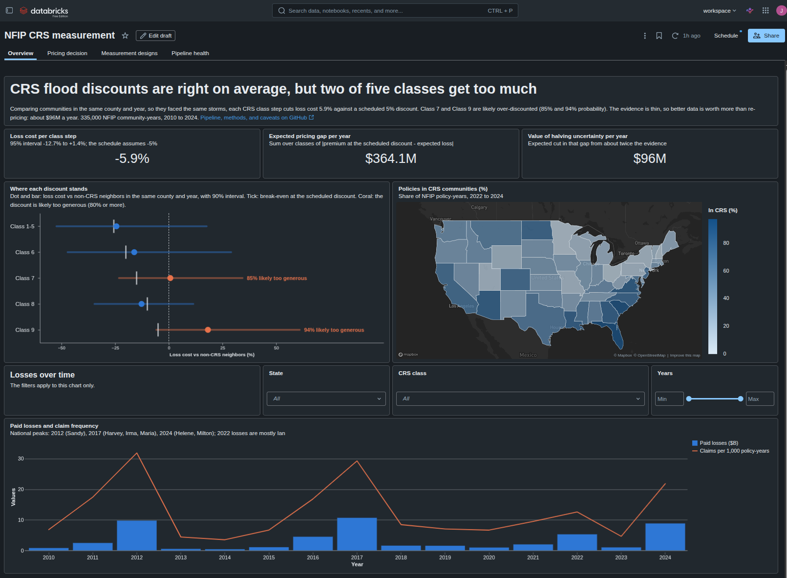

# NFIP CRS Measurement



**Business question:** FEMA's Community Rating System (CRS) gives flood insurance discounts of 5% to 45% to communities that invest in floodplain management. Are those discounts in line with the loss reduction they actually buy, and how confident can we be?

**Answer so far:** within the same county and year, each CRS class step is associated with about 5% fewer claims per policy-year (95% CI: 1.6% to 8.5%, placebo-calibrated) and about 6% lower loss cost (95% CI: 12.7% lower to 1.4% higher), against a scheduled discount of 5% per step. Discounts look priced about right on average. The causal effect of joining CRS can't be measured with public data: placebo tests show even the best available design can only detect a drop of about 50% in claims. Turned into a decision: re-pricing on today's evidence would barely reduce expected pricing error, while halving the uncertainty is worth about $96M a year, so better data is the high-value move; the Class 7 and 9 discounts are the most likely to be too generous. Details in [analysis/RESULTS.md](analysis/RESULTS.md).

**Data finding:** FEMA's redacted policies and claims stamp each community's *current* CRS class onto every historical record. The pipeline's feasibility gates caught this on the first national load, and CRS history is rebuilt from Community Status Book dates instead. See [ARCHITECTURE.md](ARCHITECTURE.md).

This repo has three parts:

1. **A data pipeline** that pulls National Flood Insurance Program (NFIP) claims, policies, and community CRS status from OpenFEMA, turns about 75 million policy transactions into earned exposure, validates and reconciles every load, and builds a national community-year panel in DuckDB.
2. **A measurement analysis** on that panel: loss cost by CRS class against the discount schedule, with county-by-year fixed effects; a within-county stacked difference-in-differences on CRS entry; placebo simulations that measure each design's bias, false-positive rate, and power; a Bayesian pricing decision analysis with value of information; and a pre-registered design for a randomized CRS recruitment trial ([analysis/EXPERIMENT.md](analysis/EXPERIMENT.md)). See [analysis/RESULTS.md](analysis/RESULTS.md).
3. **A Databricks port** that runs gold, quality checks, and analysis as a scheduled serverless job on Delta tables, deployed as an Asset Bundle, from the same SQL and Python as the local pipeline, with a parity test checking the two match. See [databricks/README.md](databricks/README.md).

## Where to start

**Presenting it:** [WALKTHROUGH.md](WALKTHROUGH.md) has a 5-minute script and likely interview questions.

**Reviewing the data engineering:** [ARCHITECTURE.md](ARCHITECTURE.md), then [pipeline/transform/sql/15_silver_policy_exposure.sql](pipeline/transform/sql/15_silver_policy_exposure.sql), [pipeline/ingest/](pipeline/ingest/), [pipeline/quality/checks.py](pipeline/quality/checks.py), and [TEST_PLAN.md](TEST_PLAN.md).

**Reviewing the measurement work:** [analysis/README.md](analysis/README.md) for the measurement plan and feasibility gates, then [analysis/RESULTS.md](analysis/RESULTS.md) and [analysis/EXPERIMENT.md](analysis/EXPERIMENT.md).

**Reviewing the platform work:** [databricks/README.md](databricks/README.md), [databricks.yml](databricks.yml), [pipeline/spark_sql.py](pipeline/spark_sql.py), and [tests/test_spark_parity.py](tests/test_spark_parity.py).

## Running it

Needs Linux or macOS, Python 3.11+, about 15 GB free disk, 16 GB RAM recommended.

```bash
python3 -m venv .venv && source .venv/bin/activate
pip install -e ".[dev,analysis]"
pytest -q                                          # 43 tests, no network needed
pip install -e ".[spark]" && pytest -q tests/test_spark_parity.py   # optional: Spark parity, needs Java 17+

# 1. API sources: national claims (about 273 API pages) and the Community Status Book
python -m pipeline.cli ingest

# 2. Policies: about 75M rows, bulk Parquet
python -m pipeline.cli download nfip_policies
#    If fema.gov blocks the scripted download, open this URL in a browser:
#    https://www.fema.gov/about/reports-and-data/openfema/v3/NfipPoliciesV3.parquet
#    then register the saved file:
python -m pipeline.cli register nfip_policies --file ~/Downloads/NfipPoliciesV3.parquet

# 3. Build silver and gold, run quality checks
python -m pipeline.cli transform
python -m pipeline.cli quality

# 4. Feasibility gates 1 and 2, and the shareable panel
python -m pipeline.cli report
python -m pipeline.cli export      # panel, plus the silver files the Databricks job lands

# 5. Analyses
python analysis/run_analysis.py data/export/community_year_panel.parquet   # estimates, about 20 s
python analysis/run_design.py data/export/community_year_panel.parquet     # placebo checks, about 25 min
python analysis/run_decision.py data/export/community_year_panel.parquet   # pricing decision, about 10 s
python analysis/run_experiment.py data/export/community_year_panel.parquet # experiment power, about 12 min

# 6. Optional: deploy to Databricks (databricks/README.md)
bash databricks/upload.sh && databricks bundle deploy && databricks bundle run nfip_pipeline
```

Every step is idempotent. Re-running `ingest` skips sources FEMA has not refreshed; `--force` overrides.

Inspect results directly:

```bash
duckdb data/warehouse.duckdb "select * from ops.run_log order by finished_at desc limit 20"
duckdb data/warehouse.duckdb "select * from ops.dq_results where not passed"
duckdb data/warehouse.duckdb "select year, sum(earned_policy_years) from gold.community_year_panel group by 1 order by 1"
```

## Layout

```
config/pipeline.yaml          datasets, scope, panel years, DuckDB limits
pipeline/ingest/              API client, pinned schemas, partition loader, bulk file register
pipeline/transform/sql/       silver and gold models, run in order, each declares its inputs
pipeline/quality/             quality and reconciliation checks, feasibility report
pipeline/cli.py               ingest | download | register | transform | quality | report | export
tests/                        unit and end-to-end tests against a fake API and synthetic policies
analysis/                     measurement plan, estimates, placebo design checks, pricing decision, experiment design
databricks.yml, databricks/   Asset Bundle: serverless job notebooks, upload script, dashboard queries
pipeline/spark_sql.py         runs the same gold SQL and quality checks on Spark
powerbi/                      Power BI alternative to the Databricks dashboard (CSV inputs in data/export/bi/)
```

## Data sources

All from [OpenFEMA](https://www.fema.gov/about/openfema/data-sets). Not official federal reports; use is subject to the [OpenFEMA terms](https://www.fema.gov/about/openfema/terms-conditions).

| Dataset | Rows | Used for |
| --- | --- | --- |
| [NFIP Redacted Claims v3](https://www.fema.gov/openfema-data-page/nfip-redacted-claims-v3) | 2.7M | Losses, 1978 onward |
| [NFIP Redacted Policies v3](https://www.fema.gov/openfema-data-page/nfip-redacted-policies-v3) | 74.7M | Exposure, premium, and CRS class by year, 2009 onward |
| NFIP Community Status Book v1 | 25k | CRS entry date and current class per community |
