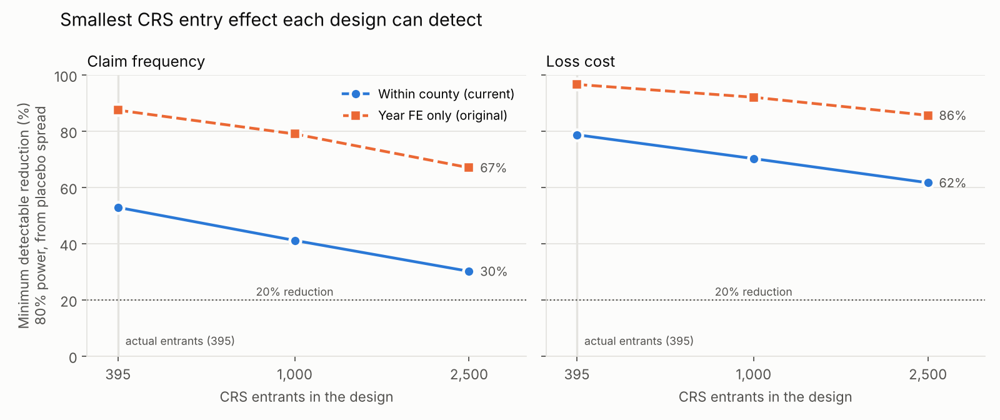

# Results

Data: national NFIP panel, 2010 to 2024, 20,668 communities, 334,656 community-years (OpenFEMA, loaded 2026-10-15). Code: [run_analysis.py](run_analysis.py) for the estimates, [run_design.py](run_design.py) for the placebo checks. Tables: [results/](results/).

## Answer

**CRS discounts look priced about right on claim frequency; loss cost points the same way but is not conclusive.** Within the same county and year, each CRS class step is associated with **5% fewer claims per policy-year** (95% CI: 1.6% to 8.5% fewer, placebo-calibrated, p = 0.005) and **6% lower loss cost** (95% CI: 12.7% lower to 1.4% higher, p = 0.10). The discount schedule gives 5% per step. Both estimates are consistent with it.

**The causal effect of joining CRS cannot be measured with public data, and the first design I used for it was broken.** Placebo tests showed the original difference-in-differences had a built-in bias of about +40% and flagged fake effects 25% of the time instead of 5%. A within-county design fixes the bias and halves the noise, but with 395 entrants it can only detect a 53% drop in claims or a 79% drop in loss cost. Detecting a 20% drop in claims would take 6,500 to 8,300 entrants; only 1,777 communities have ever joined CRS.

## A. Loss cost by CRS class (pricing adequacy)

Poisson (PPML) regression of paid claims on CRS class, with log earned policy-years as the offset and county-by-year fixed effects, controlling for SFHA share. Standard errors clustered by county. The sample is community-years whose CRS class is known (see "CRS history" below). Identification comes from the 5,170 county-years with communities in different classes.

| Model | Effect | 95% CI (analytic) | 95% CI (placebo-calibrated) | Schedule |
| --- | --- | --- | --- | --- |
| Claim frequency, per class step | -5.1% | -8.0% to -2.1% | -8.5% to -1.6% | -5% |
| Loss cost, per class step | -5.9% | -11.2% to -0.2% | -12.7% to +1.4% | -5% |
| Loss cost per step, 2010 to 2021 | -8.0% | -18.1% to +3.2% | | -5% |
| Loss cost per step, 2022 to 2024 (Risk Rating 2.0) | -0.8% | -5.5% to +4.1% | | -5% |

**Placebo calibration.** Clustered standard errors can be too small when losses are this lumpy, so [run_design.py](run_design.py) reassigns CRS classes at random among communities in each county-year (keeping each cell's mix of classes, and keeping a placebo class with the same community across years) and re-estimates 200 times. The placebo t-statistics are about 20% wider than a standard normal: 9% to 11% of placebos reach |t| > 1.96 instead of 5%. The placebo-calibrated intervals above use the placebo's 95th percentile of |t| (2.3 for claims, 2.5 for loss cost) in place of 1.96. Claim frequency survives (p = 0.005); loss cost does not quite (p = 0.10).

By class, relative to non-CRS communities in the same county and year:

| Class | Loss cost | 95% CI | Claim frequency | 95% CI | Schedule |
| --- | --- | --- | --- | --- | --- |
| 1 to 5 | -33.5% | -57.4% to +3.7% | -29.1% | -42.5% to -12.5% | -25% (Class 5) |
| 6 | -23.9% | -53.3% to +23.8% | -25.8% | -43.5% to -2.5% | -20% |
| 7 | +4.1% | -21.7% to +38.5% | -1.1% | -14.9% to +15.0% | -15% |
| 8 | -21.5% | -42.6% to +7.2% | -17.0% | -30.9% to -0.3% | -10% |
| 9 | +47.2% | +10.1% to +96.7% | +20.2% | -1.6% to +46.8% | -5% |

The pattern runs in the expected direction from Class 8 up. Class 9 communities have *higher* losses than their non-CRS neighbors. Class 9 is the entry tier, and communities often join CRS after flooding, so that reading is consistent with selection rather than with CRS raising losses.

**Robustness (loss cost per class step):**

| Variant | Effect | 95% CI |
| --- | --- | --- |
| Base | -5.9% | -11.2% to -0.2% |
| Drop 2017 (Harvey, Irma) | -6.3% | -11.7% to -0.5% |
| Drop 2012, 2017, 2024 | -9.7% | -21.5% to +3.9% |
| Drop Texas | -7.2% | -13.0% to -1.1% |
| Drop Florida | -3.6% | -10.2% to +3.5% |
| Drop Louisiana | -5.6% | -11.0% to +0.1% |
| Drop New Jersey | -6.0% | -11.7% to 0.0% |
| Drop Class 9 | -6.4% | -11.9% to -0.6% |
| Cap community-year losses at the 99th percentile | -19.9% | -25.1% to -14.3% |

The point estimate stays between -4% and -10% across sample changes, and Florida carries much of the precision. Capping extreme losses makes the association much stronger, so the relationship is clearest in ordinary years and noisiest in catastrophes. Capping is shown for diagnosis only: catastrophe losses are exactly what premiums must pay for.

**No detectable heterogeneity.** Splitting the per-step loss-cost effect by Census region, by Gulf and Atlantic coast states versus the rest, and by SFHA-share tercile gives point estimates from -7% to +3%, but tests that the groups are equal are not rejected (p = 0.21 to 0.44). The data cannot say where the discount is mispriced, only that it is not grossly mispriced on average.

**What A is and is not.** A compares communities in different classes in the same county and year. It is the right comparison for asking whether the discount schedule tracks observed losses. It is not a causal effect of CRS: communities that earn better classes also differ in capacity and income (Li and Landry, 2018), and some of that may lower losses independently.

## B. Effect of entering CRS (stacked difference-in-differences)

Each entry cohort from 2012 to 2020 is stacked with never-CRS communities **in the entrants' own counties**, over a window of three years before to four years after entry: 395 entrants, 2,307 controls, 241 counties. Entrants and controls are then summed separately within each county, stack, and year, and PPML is estimated with county-by-stack-by-group and county-by-stack-by-year fixed effects, so every comparison is between entrants and never-CRS neighbors in the same county and year. Errors are clustered by county; p-values come from the placebo distribution (section C).

| Model | Effect | 95% CI (analytic) | Placebo p |
| --- | --- | --- | --- |
| Claim frequency after entry | -11.5% | -36.8% to +23.9% | 0.51 |
| Loss cost after entry | -0.3% | -54.3% to +117.7% | 0.97 |
| Pre-entry loss gap vs same-county controls | -1.0% | -43.8% to +74.4% | |
| *Original design, for comparison:* loss cost | -11.7% | -57.0% to +81.2% | 0.59 |
| *Original design, for comparison:* claim frequency | -1.3% | -43.6% to +72.5% | 0.63 |

The analytic intervals understate the uncertainty (section C), so the placebo p-values are the ones to read. The event-study coefficients (in `results/b_entry_did.csv`) are noisy: the loss-cost lead two years before entry is +243% (CI +1% to +1,060%). With this design's 10% to 19% false-positive rate, the leads neither confirm nor reject parallel trends.

**Two findings from B:**

1. **It is underpowered, and more data of this kind would not fix it.** See section C.
2. **The "join after a flood" worry is mostly a cross-county effect.** In the raw data, entrants had about twice the loss cost of never-CRS communities in the two years before joining. Compared within the same county and year, the gap is near zero (-1%, with a wide CI). Entrants tend to be in flood-prone counties, not to be the hardest-hit community in their county. That supports using same-county comparisons.

## C. Design checks (placebo simulation)

[run_design.py](run_design.py) gives fake CRS entry dates to randomly chosen never-CRS communities, stacks them exactly as B does, and estimates the post-entry effect 150 times at each of three sizes (395 entrants, the real count; 1,000; 2,500). With no true effect, the average placebo estimate is each design's bias, the spread is its real sampling error, and the share with |t| > 1.96 is its false-positive rate. A second pass cuts the fake entrants' post-entry claims and losses by 20% to measure power.

| Design | Outcome | Bias under no effect | False-positive rate | Detectable drop at 395 entrants | at 2,500 |
| --- | --- | --- | --- | --- | --- |
| Year fixed effects only (original) | Loss cost | +41% | 25% | 97% | 86% |
| Year fixed effects only (original) | Claim frequency | +29% | 25% | 87% | 67% |
| Within county (current) | Loss cost | +2% | 19% | 79% | 62% |
| Within county (current) | Claim frequency | +2% | 10% | 53% | 30% |

"Detectable drop" is the minimum detectable effect at 80% power and 5% significance, from the placebo spread. Full table, including what the analytic standard errors would imply: `results/c_power_design.csv`. Figure: [figures/c_power_mde.png](figures/c_power_mde.png).

**What this shows:**

- **The original design was biased, not just noisy.** With only year fixed effects, county storm shocks leak into the comparison, because counties contribute different mixes of entrants and controls. Placebo estimates averaged +29% to +52% with no real effect, and the bias does not shrink with more entrants. Its reported 64% minimum detectable effect was really about 97%. County-by-year fixed effects on the community-level data would fix this but fail to converge; summing entrants and controls within each county-year first makes them estimable.
- **Analytic standard errors are too small in both designs.** Even the within-county design flags 10% to 19% of placebos at |t| > 1.96. Inference for B uses the placebo distribution instead.
- **Claim frequency is the outcome to use.** Its noise falls roughly with the square root of the number of entrants. Loss cost barely improves with more entrants, because a few catastrophes dominate it however many communities are added.
- **What it would take.** Extrapolating the placebo spread, detecting a 20% drop in claim frequency needs about 6,500 to 8,300 entrants. Only 1,777 communities have ever entered CRS. No realistic sample gets loss cost there.

## CRS history: why class changes cannot be studied

FEMA's redacted policies and claims both carry each community's **current** CRS class on every historical record. No community ever changes class in either dataset, and 91% of community-years before a community joined CRS are stamped as CRS. Class history is rebuilt from Community Status Book dates instead:

- Before the CRS entry date, a community is not in CRS (Class 10).
- From the current class's effective date onward, it has the current class.
- In between, it is in CRS with an unknown class, and excluded from A.

So A uses 9,413 CRS community-years with a known class, weighted toward recent years (224 CRS communities have a known class in 2010, 1,249 in 2024). The planned class-step design needs year-by-year class history and is not feasible with public data.

## Tried and dropped

These were run on the full panel and left out because they add noise, not evidence. The reasoning is kept here so it is not repeated.

- **Entry effects by cohort.** Cohorts have 14 to 49 entrants each; estimates ran from -79% to +980%.
- **Pre-trend sensitivity bounds** (relative magnitudes, in the spirit of Rambachan and Roth). The largest change between pre-entry years was 171%, so even mild assumptions produced bounds from -86% to +113%.
- **A predictive loss-cost model** (Tweedie GLM and LightGBM, trained on 2012 to 2019, tested on 2022 to 2024). 90% of test-period losses were in Florida, mostly Hurricane Ian, against 6% of training losses, so state effects learned that Florida was low risk and the model ranked risk worse than a flat rate. A GLM on FEMA's Risk Rating 2.0 premium alone ranked 2022 to 2024 losses best (Gini 0.58). Out-of-time flood evaluation mostly measures where the next hurricane lands.

## Limitations

- A is an association within county and year, not a causal effect.
- Known-class years skew recent. That is also why the 2010 to 2021 estimate is less precise than the full window.
- Communities that entered CRS and later left are excluded after entry (3,746 community-years), which keeps the data clean but may favor successful participants.
- The most recent claim years are still developing, so 2025 and 2026 are excluded.
- Loss cost uses NFIP paid amounts only, not uninsured damage.

## Next steps

- Recover historical CRS classes from FEMA's semiannual CRS community lists. That would unlock the class-step design and expand A's 2010 to 2021 sample.
- A Bayesian hierarchical model of class effects, to stabilize the noisy class-by-class estimates through partial pooling.
- Separate building from contents losses, and SFHA from non-SFHA exposure.
